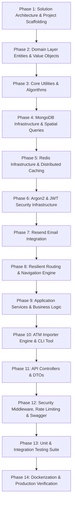

# خطة التحويل الشاملة من Node.js (NestJS) إلى .NET 10 (C# / ASP.NET Core)
## مشروع: أقرب ماكينة ليك (Aqrab Makina Leek — Nearest ATM For You)

> **الهدف:** إعادة بناء وترحيل النظام بالكامل بكل تفاصيله الدقيقة، خوارزمياته، نماذج بياناته، ونظام الحماية والملاحة، من Node.js / NestJS إلى .NET 10 بأعلى معايير **Clean Architecture** و **Enterprise Best Practices**.

---

## المقارنة التقنية بين النظامين (Tech Stack Mapping)

| المكون (Component) | في Node.js (NestJS) الحالي | المقابل في .NET 10 (C#) الجديد |
|---|---|---|
| **Runtime & Framework** | Node.js 22 LTS + NestJS 11 | **.NET 10 SDK + ASP.NET Core Web API** |
| **Language** | TypeScript (Strict mode) | **C# 13 / 14 (Nullable Reference Types, Records, Pattern Matching)** |
| **Architecture** | NestJS Modular Architecture | **Clean Architecture (Domain, Application, Infrastructure, WebAPI)** |
| **Database & Spatial** | MongoDB + Mongoose (2dsphere index) | **MongoDB.Driver (Official C# Driver) + GeoJson2DGeographicCoordinates** |
| **Caching & In-Memory** | ioredis (Redis) | **StackExchange.Redis + Microsoft.Extensions.Caching.StackExchangeRedis** |
| **Password Hashing** | argon2 | **Isopoh.Cryptography.Argon2** (Argon2id implementation) |
| **Authentication & Tokens**| `@nestjs/jwt` (Access/Refresh/Reset) | **Microsoft.AspNetCore.Authentication.JwtBearer + System.IdentityModel.Tokens.Jwt** |
| **Validation** | `class-validator` + `zod` | **FluentValidation** (Strongly-typed validation pipeline) |
| **Rate Limiting** | `@nestjs/throttler` (Redis-backed) | **System.Threading.RateLimiting** (.NET Native RateLimiting with Redis partitioner) |
| **Email Service** | `resend` SDK + Dev Console | **Resend .NET Client / HttpClientFactory + IEmailService** |
| **Routing / Navigation** | OSRM + ORS + Fallback | **HttpClientFactory + Polly (Resilience, Retry, Timeout) + FallbackProvider** |
| **Arabic Normalization** | Regex utility in TypeScript | **C# Regex + Span<char> / StringBuilder High-Performance Normalizer** |
| **Time & Cairo Clock** | `Intl.DateTimeFormat` (Africa/Cairo) | **TimeZoneInfo.FindSystemTimeZoneById("Africa/Cairo" / "Egypt Standard Time")** |
| **API Documentation** | `@nestjs/swagger` | **Swashbuckle / Microsoft.AspNetCore.OpenApi + Scalar / Swagger UI** |
| **Structured Logging** | `nestjs-pino` (Pino) | **Serilog (Serilog.AspNetCore + Serilog.Sinks.Console / Seq / JSON formatting)** |
| **Testing** | Jest + Supertest | **xUnit + FluentAssertions + Moq + WebApplicationFactory** |

---

## مراحل التحويل الـ 14 (The 14 Migration Phases)

---

### Phase 1: Solution Architecture & Project Scaffolding 🏗️
> إعداد هيكل الـ Solution والمشاريع وفقاً لـ Clean Architecture

| # | Task | Description |
|---|---|---|
| 1.1 | Create .NET Solution (`AqrabMakinaLeek.sln`) | إنشاء ملف الـ Solution الرئيسي |
| 1.2 | Scaffold `AqrabMakinaLeek.Domain` | Class Library للأعمال وقواعد البيانات الصافية بدون أي Dependencies خارجية |
| 1.3 | Scaffold `AqrabMakinaLeek.Application` | Class Library للـ DTOs والـ Interfaces والـ Validation والـ Use Cases |
| 1.4 | Scaffold `AqrabMakinaLeek.Infrastructure` | Class Library للـ MongoDB والـ Redis والـ Resend والـ JWT والـ OSRM |
| 1.5 | Scaffold `AqrabMakinaLeek.WebApi` | ASP.NET Core Web API للمسارات والـ Controllers والـ Middlewares |
| 1.6 | Scaffold `AqrabMakinaLeek.Importer` | Console CLI App لاستيراد بيانات `data/atms.json` |
| 1.7 | Scaffold `AqrabMakinaLeek.UnitTests` | xUnit Test Project لاختبار الخوارزميات والـ Services |
| 1.8 | Scaffold `AqrabMakinaLeek.IntegrationTests` | xUnit Test Project لاختبار الـ Endpoints والـ Flows الكاملة |
| 1.9 | Configure Project References & Directory.Build.props | ضبط التبعيات بين المشاريع والإعدادات المشتركة (Nullable, ImplicitUsings, Strict) |

---

### Phase 2: Domain Layer — Entities, Enums & Value Objects 📦
> بناء الكيانات والنماذج الأساسية للبيانات

| # | Task | Description |
|---|---|---|
| 2.1 | Define `AtmBank` Enum | قائمة البنوك الـ 17 المعتمدة (NBE, BANQUE_MISR, CIB, QNB, إلخ) مع كود التحويل |
| 2.2 | Define `TravelMode` Enum | وسيلة الانتقال (`walk`, `drive`) |
| 2.3 | Define `AtmReportStatus` Enum | حالات البلاغات (`WORKING`, `EMPTY_CASH`, `OUT_OF_SERVICE`) |
| 2.4 | Define `GeoPoint` Value Object | كائن الإحداثيات الجغرافية (Longitude, Latitude) مع التوافق مع GeoJSON |
| 2.5 | Define `OpeningHours` & `OpeningHoursInterval` | هيكل مواعيد العمل لكل أيام الأسبوع مع دعم الفترات الممتدة بعد منتصف الليل |
| 2.6 | Define `Atm` Domain Entity | كيان الماكينة بالكامل (الموقع، الاسم، البنك، العنوان، 24h، الكراسي المتحركة، البحث) |
| 2.7 | Define `User` Domain Entity | كيان المستخدم (الاسم، الإيميل، الهاش، اللغة، التوجيه الصوتي، Soft Delete) |
| 2.8 | Define `RefreshToken` Domain Entity | كيان التوكن المنعش (Hash, FamilyId, ExpiresAt, RevokedAt, DeviceInfo) |
| 2.9 | Define `AtmReport` Domain Entity | كيان بلاغات الماكينات وتاريخها ومصدرها |
| 2.10 | Define `Favorite` Domain Entity | كيان الماكينات المفضلة لكل مستخدم |
| 2.11 | Define `RecentSearch` Domain Entity | كيان عمليات البحث الأخيرة للمستخدم |

---

### Phase 3: Core Utilities & High-Performance Algorithms 🧠
> ترجمة الخوارزميات الحسابية والنصية الدقيقة إلى C# عالي الأداء

| # | Task | Description |
|---|---|---|
| 3.1 | Implement `ArabicNormalizeUtil` | خوارزمية تنظيف وتوحيد الحروف العربية (الهمزات، الياء، التاء المربوطة، التشكيل، التطويل) باستخدام `Regex` و `ReadOnlySpan<char>` |
| 3.2 | Implement `GeoUtil` | معادلة Haversine لحساب المسافات بالمتر بين الإحداثيات، وتقريب الإحداثيات لـ 4 أرقام عشرية للكيش |
| 3.3 | Implement Egypt Bounding Box Validator | التحقق من أن الإحداثيات تقع داخل حدود جمهورية مصر العربية ومحافظة الفيوم |
| 3.4 | Implement `CairoTimeUtil` | التعامل الدقيق مع توقيت القاهرة `Africa/Cairo` بالتوقيت الصيفي وحساب بداية اليوم (Midnight) |
| 3.5 | Implement `OpenNowEvaluator` | خوارزمية تحديد هل الماكينة مفتوحة حالياً (OPEN / CLOSED / UNKNOWN) مع فحص فترات الـ Overnight |
| 3.6 | Implement `ReportSummaryCalculator` | خوارزمية وزن البلاغات الأحدث (Recency-Weighted over 6 hours) ومعالجة حالات التعادل |
| 3.7 | Implement `DurationParser` | محول النصوص الزمنية (مثل `15m`, `30d`, `60s`) إلى `TimeSpan` و Milliseconds |

---

### Phase 4: Infrastructure Foundation — MongoDB Persistence & Spatial Queries 🗄️
> بناء طبقة قواعد البيانات بالـ MongoDB C# Driver الرسمي

| # | Task | Description |
|---|---|---|
| 4.1 | Install & Configure `MongoDB.Driver` | ربط الـ Driver بحقن التبعيات (DI) وقراءة `MongoUri` |
| 4.2 | Configure BsonClassMap & Conventions | ضبط الـ CamelCase convention والـ ObjectId mapping والـ Timestamps |
| 4.3 | Create MongoDB Collections Context (`MongoDbContext`) | توفير وصول قوي للكولكشنز (`Atms`, `Users`, `RefreshTokens`, `Reports`, إلخ) |
| 4.4 | Configure 2dsphere Spatial Index | إنشاء الـ 2dsphere index على حقل `location` برمجياً عند بدء التشغيل |
| 4.5 | Configure Compound & Unique Indexes | إنشاء الفهارس الفريدة لـ `(source, sourceId)`، والـ text search على `searchText` |
| 4.6 | Implement `AtmRepository` with `$geoNear` Aggregation | كتابة استعلام `$geoNear` بالـ Driver لجلب أقرب الماكينات وحساب المسافة بدقة |
| 4.7 | Implement `UserRepository` | عمليات البحث بالإيميل المعياري، الـ Soft Delete، والتحديث |
| 4.8 | Implement `RefreshTokenRepository` | عمليات الحفظ، التدوير، وإلغاء العائلة الكاملة (Family Revocation) |
| 4.9 | Implement `ReportRepository`, `FavoriteRepository`, `RecentSearchRepository` | الاستعلامات المخصصة لكل موديول |

---

### Phase 5: Infrastructure Foundation — Redis Caching & Distributed Storage ⚡
> ربط وإدارة Redis للكاش وأكواد الـ OTP والـ Rate Limiting

| # | Task | Description |
|---|---|---|
| 5.1 | Install & Configure `StackExchange.Redis` | ربط Redis عبر `IConnectionMultiplexer` مع معالجة انقطاع الاتصال التلقائي |
| 5.2 | Implement `IRedisService` Wrapper | واجهة موحدة لعمليات `GetAsync`, `SetAsync` مع TTL، و `DeleteAsync` |
| 5.3 | Implement OTP Redis Store | تخزين كود الـ OTP مشفراً بـ SHA-256 مع TTL 10 دقائق وحد أقصى 5 محاولات و Cooldown دقيقة |
| 5.4 | Implement Route Cache Service | كاش مسارات الخريطة لمدة 60 ثانية باستخدام مفاتيح إحداثيات مقربة |
| 5.5 | Implement Redis Health Check | التحقق من صحة اتصال Redis لدمجه في مسار `/v1/health` |

---

### Phase 6: Security Infrastructure — Argon2 Hashing & JWT Token Lifecycle 🔐
> تنفيذ معايير التشفير والأمان القوية

| # | Task | Description |
|---|---|---|
| 6.1 | Implement `PasswordHasher` (Argon2id) | تشفير كلمات المرور باستخدام مكتبة `Isopoh.Cryptography.Argon2` بنفس إعدادات المشروع الحالي |
| 6.2 | Implement `JwtTokenService` | توليد والتحقق من Access Token (15m)، و Reset Token (10m) |
| 6.3 | Implement `RefreshTokenService` with Family Rotation | توليد Cryptographic Random Opaque Tokens وحفظ الـ Hash واكتشاف إعادة الاستخدام (Reuse Detection) |
| 6.4 | Configure ASP.NET Core JWT Bearer Authentication | ضبط Authentication Middleware للتحقق التلقائي من التوكن واستخراج الـ Claims |

---

### Phase 7: Infrastructure — Email Provider (Resend & Dev Fallback) 📧
> إرسال الإيميلات وقوالب التحقق

| # | Task | Description |
|---|---|---|
| 7.1 | Define `IEmailService` & `EmailMessage` | واجهة إرسال البريد الإلكتروني مع دعم الـ Plain Text والـ HTML |
| 7.2 | Implement `ResendEmailService` | إرسال الإيميل عبر Resend REST API |
| 7.3 | Implement `ConsoleEmailService` | تسجيل نص الإيميل وكود الـ OTP في الـ Console لبيئة التطوير المحلي |
| 7.4 | Dynamic Email Provider Factory | التبديل التلقائي بين Resend والـ Console بناءً على وجود `RESEND_API_KEY` والـ Environment |
| 7.5 | Build HTML & Text Email Templates | قالب بريد إلكتروني تفاعلي متجاوب لإرسال رمز التحقق (OTP) للمستخدم |

---

### Phase 8: Resilient Routing & Navigation Engine 🗺️
> محرك الملاحة وحساب المسارات بنظام Fallback متين

| # | Task | Description |
|---|---|---|
| 8.1 | Define `IRoutingProvider` Interface | واجهة حساب المسار (Coordinate from, Coordinate to, Mode) |
| 8.2 | Implement `OsrmRoutingProvider` | الاتصال بـ OSRM API وحساب المسار بـ Polyline والمسافة والزمن التقديري |
| 8.3 | Implement `OrsRoutingProvider` | الاتصال بـ OpenRouteService API مع دعم الـ API Key |
| 8.4 | Implement `StraightLineFallbackProvider` | خط سير مستقيم ذكي مع سرعة مشي 78 م/دقيقة وسرعة سيارة 25 كم/ساعة وعلامة `approximate=true` |
| 8.5 | Configure Polly Resilience Pipeline | تحديد مهلة 5 ثوانٍ (Timeout) وإعادة المحاولة والتحويل التلقائي للـ Fallback عند أي عطل خارجي |
| 8.6 | Caching Layer for Routes | فحص الـ Cache أولاً قبل استدعاء أي سيرفر ملاحة خارجي |

---

### Phase 9: Application Services & Business Logic ⚙️
> منطق الأعمال لكل ميزات التطبيق

| # | Task | Description |
|---|---|---|
| 9.1 | Implement `AuthService` | التسجيل، الدخول، التدوير، الخروج، واستعادة كلمة المرور عبر OTP |
| 9.2 | Implement `AccountService` | استرجاع وتحديث البروفايل، تغيير الباسورد، وحذف الحساب مع تأكيد كلمة المرور الحالية |
| 9.3 | Implement `AtmsService` | الاستعلام عن الماكينات القريبة، البحث المتقدم، وتفاصيل الماكينة مع المسافة |
| 9.4 | Implement `SearchService` | توليد استعلام البحث النصي وتطبيقه على حقل `searchText` المنظف |
| 9.5 | Implement `ReportsService` | إضافة بلاغ جديد مع فحص الـ Cooldown وحساب ملخص البلاغات الحالي |
| 9.6 | Implement `FavoritesService` | إضافة وحذف واستعراض الماكينات المحفوظة وترتيبها وحساب المسافة |
| 9.7 | Implement `RecentSearchesService` | تسجيل عمليات البحث مع إلغاء التكرار والاحتفاظ بآخر 10 عمليات فقط |
| 9.8 | Implement `NavigationService` | التنسيق بين موقع المستخدم والماكينة المختارة ومحرك الـ Routing |

---

### Phase 10: ATM Data Importer Engine & CLI Tool 📥
> ترحيل سكربت استيراد بيانات Google Places الحقيقية

| # | Task | Description |
|---|---|---|
| 10.1 | Create Importer CLI Project (`AqrabMakinaLeek.Importer`) | أداة سطر أوامر للتشغيل المستقل عبر `dotnet run` |
| 10.2 | Implement JSON Deserializer & Validator | قراءة ملف `data/atms.json` واستخراج السجلات والتحقق من صحتها |
| 10.3 | Implement `AtmJsonMapper` | تحويل بيانات Google Places لكيانات `Atm`، مع تصنيف البنك وفحص مصر واستخراج المواعيد |
| 10.4 | Implement Near-Duplicate Detection | استبعاد الماكينات المكررة التي تقل المسافة بينها عن 15 متراً |
| 10.5 | Implement BulkWrite Upsert Engine | تنفيذ عمليات الـ Upsert غير المتكررة (Idempotent) بالـ MongoDB BulkWrite |
| 10.6 | Support `--dry-run` and `--file` Flags | دعم فحص البيانات وتجربتها بدون كتابة فعلية في الداتابيز |

---

### Phase 11: Presentation Layer — API Controllers & DTOs 🌐
> إنشاء جميع الـ Endpoints القياسية تحت المسار `/v1`

| # | Task | Description |
|---|---|---|
| 11.1 | Setup API Versioning (`/v1`) | دعم الـ URL Versioning في ASP.NET Core |
| 11.2 | Implement `AuthController` | مسارات (`register`, `login`, `refresh`, `logout`, `forgot-password`, `verify-otp`, `reset-password`) |
| 11.3 | Implement `AccountController` (`/v1/auth/me`) | مسارات (`GET /me`, `PATCH /me`, `POST /me/change-password`, `DELETE /me`) |
| 11.4 | Implement `AtmsController` | مسارات (`GET nearby`, `GET search`, `GET :id`) |
| 11.5 | Implement `ReportsController` | مسارات (`POST :id/reports`, `GET :id/reports`) |
| 11.6 | Implement `FavoritesController` (`/v1/me/favorites`) | مسارات (`GET`, `PUT :atmId`, `DELETE :atmId`) |
| 11.7 | Implement `RecentSearchesController` (`/v1/me/recent-searches`) | مسارات (`GET`, `POST`, `DELETE`) |
| 11.8 | Implement `NavigationController` (`/v1/navigation/route`) | مسار حساب المسار التقديري |
| 11.9 | Implement `HealthController` (`/v1/health`) | مسار فحص صحة MongoDB و Redis |

---

### Phase 12: Security Middleware, Rate Limiting & Swagger 🛡️
> الحماية المتقدمة والتوثيق والـ Filters

| # | Task | Description |
|---|---|---|
| 12.1 | Implement Standardized Error Filter | إرجاع الأخطاء بنظام `{ statusCode, code, message }` المتوافق تماماً مع التطبيق الحالي |
| 12.2 | Configure FluentValidation Pipeline | التحقق التلقائي الصارم من جميع الـ DTOs ورفض الحقول الزائدة أو غير الصحيحة |
| 12.3 | Implement Rate Limiting Middleware | تطبيق الـ Throttling المخصص (Auth: 10/min, Reports: 5/min, Global: 300/min) |
| 12.4 | Configure Security Headers & CORS | تطبيق Headers الأمان المتوافقة مع Helmet ودعم الـ CORS |
| 12.5 | Implement Request ID Middleware | توليد `X-Request-Id` وتمريره في الـ Headers وتسجيله في كل اللوجات |
| 12.6 | Configure Serilog & Sensitive Data Masking | تسجيل Structured JSON Logs مع حجب كلمات المرور والتوكنز |
| 12.7 | Configure OpenAPI / Swagger UI | توثيق كامل مع Bearer Token Auth على الرابط `/docs` |

---

### Phase 13: Unit & Integration Testing Suite 🧪
> اختبارات شاملة تغطي 100% من المسارات والخوارزميات

| # | Task | Description |
|---|---|---|
| 13.1 | Unit Tests for `ArabicNormalizeUtil` | اختبار جميع حالات الحروف والهمزات والتشكيل والتطويل |
| 13.2 | Unit Tests for `GeoUtil` & `CairoTimeUtil` | اختبار معادلات المسافات وتوقيت القاهرة والـ Overnight Hours |
| 13.3 | Unit Tests for `ReportSummaryCalculator` | اختبار خوارزمية أوزان البلاغات والتعادل والغياب |
| 13.4 | Unit Tests for `AuthService` & `PasswordHasher` | اختبار التسجيل والدخول والتوكنز والـ OTP |
| 13.5 | Unit Tests for `AccountController` & `DeleteAccount` | اختبار تأكيد الباسورد وتعديل البروفايل |
| 13.6 | Unit Tests for `RoutingProviders` & Fallback | اختبار استدعاءات OSRM والتحول للـ Fallback |
| 13.7 | Integration Tests with `WebApplicationFactory` | اختبار دورة الـ Auth والـ Navigation كاملة من الطلب للاستجابة |

---

### Phase 14: Dockerization, Production Readiness & Verification 🚀
> تجهيز ملفات الدوكر والتحقق النهائي

| # | Task | Description |
|---|---|---|
| 14.1 | Create Multi-Stage `Dockerfile` | صورة .NET 10 مصغرة وخفيفة للـ Production (chiseled/alpine runtime) |
| 14.2 | Update `docker-compose.yml` | تشغيل الـ API الجديد مع MongoDB 7 و Redis والـ Importer |
| 14.3 | Configuration & Secrets Mapping | تجهيز `appsettings.json` و `appsettings.Development.json` ودعم قراءة الـ Environment Variables |
| 14.4 | End-to-End Verification Pipeline | بناء المشروع وتشغيل كافة الاختبارات بنجاح |
| 14.5 | Production Documentation & Migration Report | كتابة دليل التشغيل الشامل للنسخة الجديدة |

---

## خطة التنفيذ المقترحة 📋

سنبدأ في تنفيذ هذه المراحل مرحلة تلو الأخرى بتنظيم شديد:
1. **الخطوة الأولى:** البدء في **Phase 1 (هيكلة الـ Solution وإنشاء المشاريع)**.
2. بعد كل مرحلة، يتم عمل Build وفحص والتأكد من تمامها قبل الانتقال للمرحلة التالية.
